<p align="center">
  
</p>

<h1 align="center">有梧</h1>

<p align="center"><strong>校园大小事，有梧搞定。</strong></p>

有梧是一款面向梧州学院学生的校园生活聚合应用，可以查看课程表、启动校园饮水设备，以及通过蓝牙连接浴室热水器。

| 课程 | 喝水 | 洗澡 |
| :---: | :---: | :---: |
| 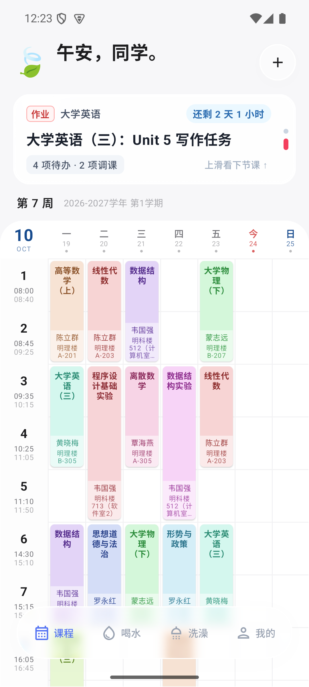 | 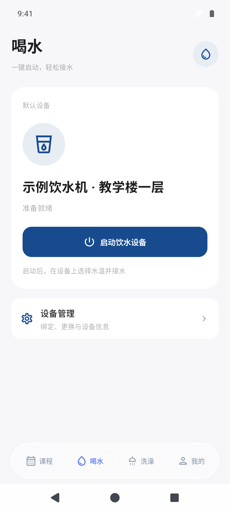 | 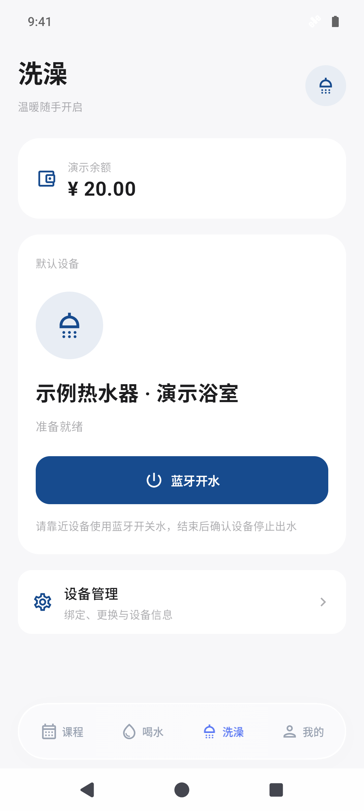 |


## 功能

- **自动更新的课程表**：自动从教务系统同步课程。显示课程时间、教师、教室及下一节课倒计时。
- **饮水设备**：一键式，零广告的启动饮水机。
- **洗澡服务**：一键式，零广告的启动热水器。
- **桌面组件**：提供 2×2 的「下一节课」和 4×2 的「下一节课 · 今日概览」，根据上课、课间、课程结束和无课状态切换显示。

| 深色课程表 | 深色洗澡页面 |
| :---: | :---: |
| 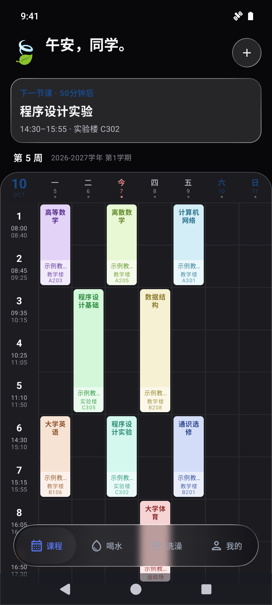 | 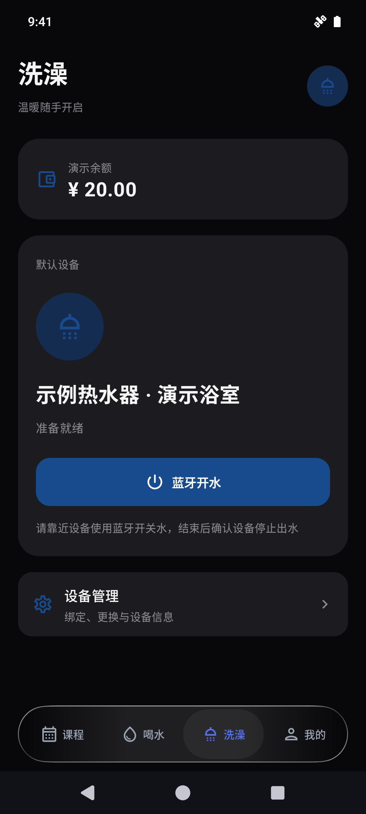 |

## 使用

运行环境为 Android 8.0（API 26）及以上。当前 Release 构建仅包含 `arm64-v8a`，适用于 64 位 ARM 设备。

### 初次设置与课表同步

1. 打开应用，按「欢迎 → 教务 → 服务 → 偏好 → 完成」进行初次设置。
2. 使用学号和教务密码登录，等待首次课表获取完成。
3. 核对「第一周第一天」、学期周数和上课时间，再按需要开启周末显示。
4. 在「我的 → 同步与数据」查看同步状态、手动同步或打开「课程表洞察」。

开启自动更新需要在教务登录时勾选「记住密码并自动更新课表」。后台任务按 6 小时间隔调度，实际执行时间受网络和系统后台限制影响。

| 欢迎与设置流程 | 课表偏好 | 同步与数据 |
| :---: | :---: | :---: |
| 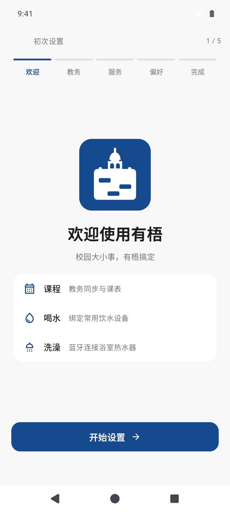 | 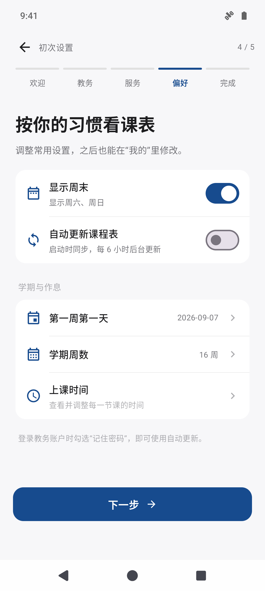 | 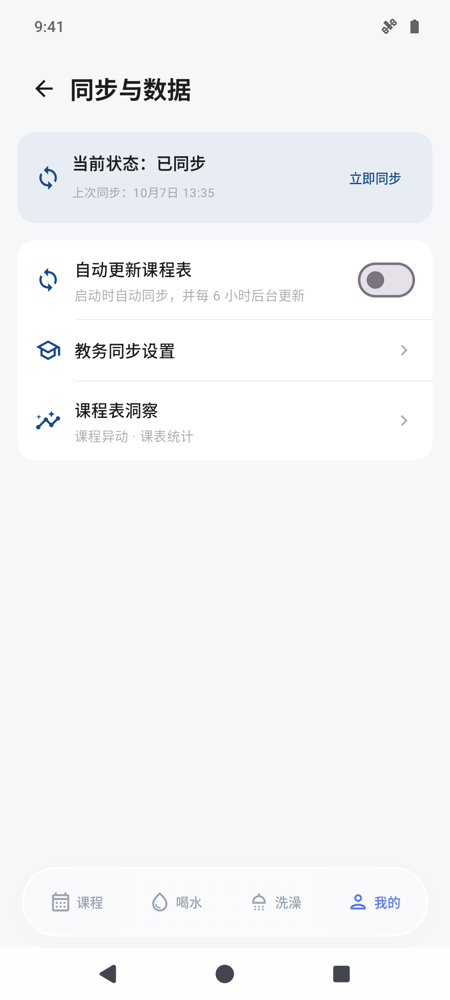 |

当前教务同步适配梧州学院的新正方教务系统。Python 桥接层使用固定学校地址；更换学校需要修改适配代码。

教务密码使用 Android Keystore 管理密钥，通过 AES-GCM 加密保存在本机；课表同步直接连接学校教务系统。

### 喝水与洗澡

教务、喝水和洗澡使用各自的账户，需要分别登录。

| 服务 | 登录与绑定 | 使用方式 |
| --- | --- | --- |
| 喝水 | 手机号、图形验证码和短信验证码；扫码或输入设备编号绑定 | 选中默认设备，点击「启动饮水设备」，随后在饮水机上选择水温并接水 |
| 洗澡 | 手机号与密码或短信验证码；蓝牙扫描、扫码或输入设备编号绑定 | 开启蓝牙并允许相关权限，靠近热水器开水；结束后在设备旁关水，确认停止出水与结算状态 |

| 饮水设备管理 | 洗澡设备管理 |
| :---: | :---: |
| 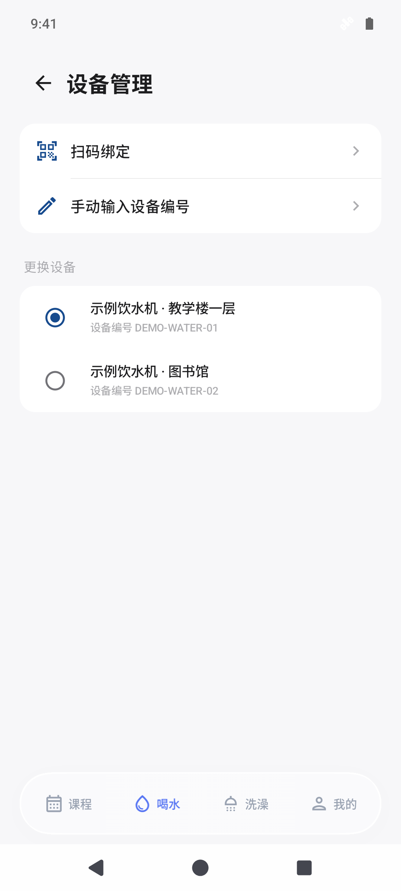 | 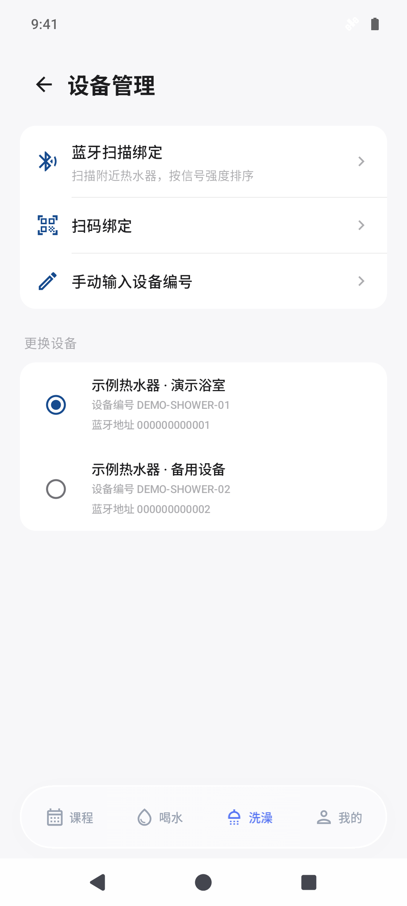 |

扫码需要相机权限；蓝牙扫描与连接需要相应权限，旧版 Android 的扫描还需要定位权限。设备控制依赖当前适配的校园服务和设备协议。

### 桌面组件

长按桌面空白处，在系统组件列表中找到有梧，添加「下一节课」或「下一节课 · 今日概览」。组件读取本地课表，点击课程可进入应用查看详情。

| 即将上课 | 正在上课 | 今天无课 |
| :---: | :---: | :---: |
| 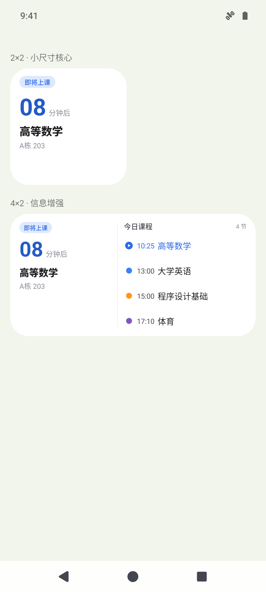 | 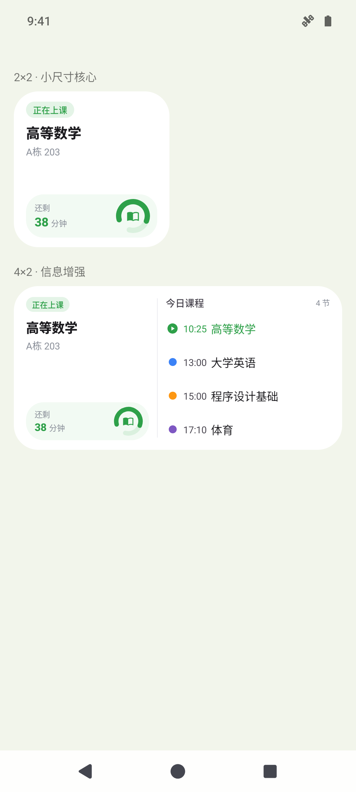 | 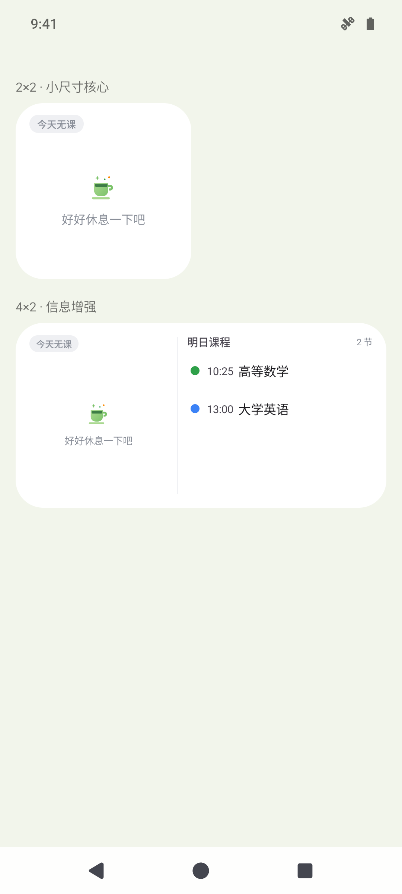 |

[查看组件的完整状态示例](docs/screenshots/widget-states.png)，包括课间、下一节课、今日课程结束及长课程名显示。

## 从源码构建

### 环境要求

以下命令在 Windows PowerShell 中执行，工作目录为项目根目录。

| 项目 | 要求 |
| --- | --- |
| JDK | 17，配置 `JAVA_HOME`，或使用 Android Studio 的 Gradle JDK 设置 |
| Android SDK | Android SDK Platform 36、Build Tools 36.0.0、Platform Tools |
| Gradle | 使用仓库内 Wrapper，版本为 8.14.3 |
| Python | Chaquopy 内嵌 Python 3.13；教务 SDK 从 `vendor/` 中的 wheel 安装 |

用 Android Studio 打开项目并配置 SDK 路径，或在本机 `local.properties` 中设置 `sdk.dir`。首次构建需要下载 Gradle、Android 依赖和 Python 依赖。

### 构建与安装

```powershell
# 构建调试包
.\gradlew.bat :app:assembleDebug

# 通过 ADB 安装到已连接的设备或模拟器
adb install -r .\app\build\outputs\apk\debug\app-debug.apk
```

Debug 构建包含 `arm64-v8a` 和 `x86_64`。应用包名为 `com.fengkao.timetable`。

### 离线演示

项目提供独立的 Demo 构建，使用示例课程和设备展示界面，无需真实账户。Demo 清单移除了网络和蓝牙权限，不能执行实际同步或开关水。

```powershell
.\gradlew.bat :app:assembleDemo
adb install -r .\app\build\outputs\apk\demo\app-demo.apk
adb shell am start -S -n com.fengkao.timetable.demo/com.fengkao.timetable.demo.DemoActivity
```

演示入口支持通过 `screen` 参数选择页面，例如：

```powershell
# 查看饮水页面
adb shell am start -S -n com.fengkao.timetable.demo/com.fengkao.timetable.demo.DemoActivity --es screen water

# 查看初次设置中的偏好页面（步骤从 0 开始）
adb shell am start -S -n com.fengkao.timetable.demo/com.fengkao.timetable.demo.DemoActivity --es screen welcome --ei step 3
```

### 饮水服务配置

```powershell
Copy-Item .\water.properties.example .\water.properties
```

在 `water.properties` 中填写当前适配服务的配置，再重新构建：

```properties
API_GATEWAY=
API_CID=
```

`API_GATEWAY` 必须是有效的 HTTPS 网关，`API_CID` 为该服务对应的客户端标识。两项留空不影响源码编译，实际喝水页面会提示服务未配置。Demo 使用独立的演示状态。

### Release 签名

```powershell
Copy-Item .\keystore.properties.example .\keystore.properties
```

将自己的密钥库放到本机，在 `keystore.properties` 中设置 `storeFile`、`storePassword`、`keyAlias` 和 `keyPassword`，然后构建：

```powershell
.\gradlew.bat :app:assembleRelease
```

输出位于 `app/build/outputs/apk/release/`。未配置有效密钥库时生成未签名 APK，需要签名后才能安装。实际服务配置、签名凭据及密钥库均不应提交到仓库。

### 测试

```powershell
.\gradlew.bat :app:testDebugUnitTest
```

现有单元测试覆盖学期与周次计算、课表缓存、初次设置进度、校园服务接口、蓝牙协议和组件尺寸计算等逻辑。

## 项目结构

```text
app/src/main/
├── java/com/fengkao/timetable/
│   ├── data/       课表同步、本地存储与校园服务接口
│   ├── ui/         课程、喝水、洗澡、设置及统计界面
│   └── widget/     桌面组件与状态更新
├── python/         教务系统 Python 桥接层
└── res/            Android 资源与组件布局
app/src/demo/       离线演示入口与示例数据
app/src/test/       单元测试
docs/screenshots/   界面截图
gradle/             Wrapper 与依赖版本配置
scripts/            构建辅助脚本
vendor/             随仓库提供的教务 SDK 与许可证
```

界面使用 Kotlin、Jetpack Compose 和 Material 3；本地设置使用 DataStore，后台同步使用 WorkManager，教务同步通过 Chaquopy 调用 Python SDK。

## 许可证

本项目采用 [MIT License](LICENSE)。随仓库提供的教务 SDK 许可证见 [vendor/LICENSE-school-sdk](vendor/LICENSE-school-sdk)；其他依赖的许可信息可在应用「我的 → 关于 → 开源许可」中查看。
